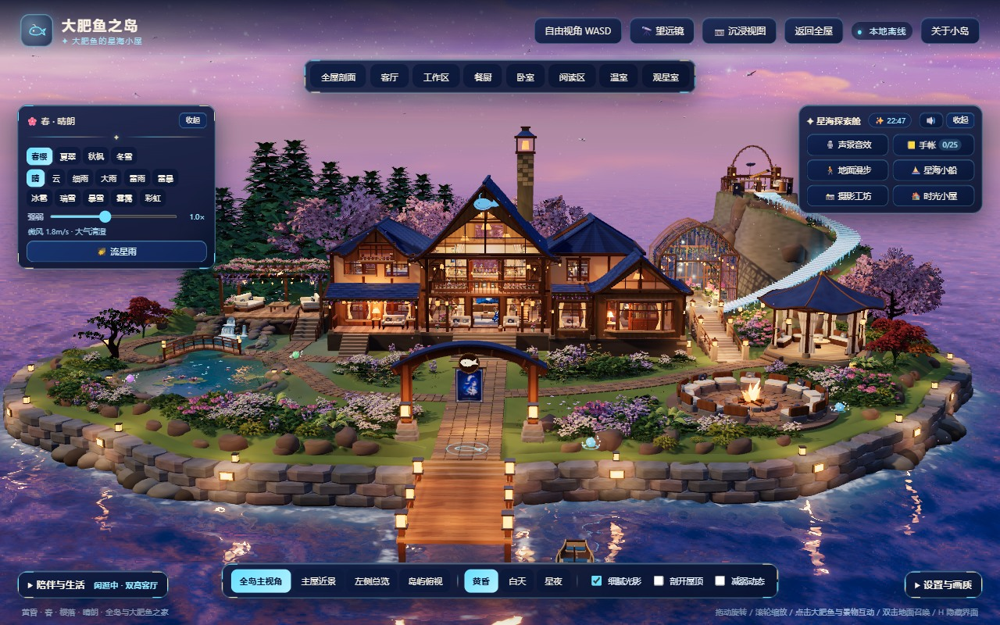
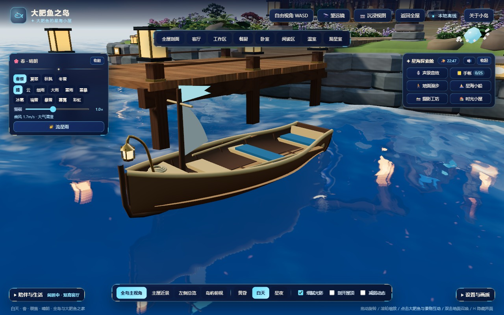

# 星海回响 1.3.2 - 大肥鱼之岛小船重塑、探索舱与流畅度优化版

自 1.3 起，项目由「伪从绫开始的面板」正式更名为「星海回响」；在 **1.3.2** 小版本更新中，3D 鲸鱼小岛独立体验同步定名为 **「大肥鱼之岛」**。为兼容旧版升级，仓库地址、版本号序列（`1.3.0 -> 1.3.1 -> 1.3.2`）与插件 ID `dsh-whale-status` 继续沿用，已有数据和设置保持保留。

作者：**xinghailiuli**。

大肥鱼之岛 1.3.2：在 1.3.1 的 13 处地标互动与 23 锚点自主漫游基础上，完成南码头星海小船立体船体重塑、星海探索舱 HUD、离岸蓝鲸与海鸥蝶群生态、Web Audio 实时程序声景、星海手帐 25 项收集、地面第一人称漫步、2K 明信片工坊、时光小屋道具及全档位流畅度调优。完整独立离线体验压缩包仅约 19.11 MB，解压后双击 `开始使用.html` 即可离线游玩。





## 本次更新（1.3.2）

从 v1.3.1 升级为 **v1.3.2**：

- **南码头星海小船重塑与环岛巡游**：告别原本平板木船，全新雕刻立体弧线木质船身（船肋、软垫长凳、弯钩暖光提灯、倾斜桅杆风帆、燕尾星海旗与尾流动画），登船即可环岛巡游并偶遇离岸跃水蓝鲸。
- **「星海探索舱」HUD 与多端零重叠布局**：右上角集成声景、手帐、漫步、小船、摄影与时光小屋控制舱，通过 1280x800、522x593 窄侧栏及 390x844 移动端全 UI 零重叠校验。
- **离岸蓝鲸生态与分级海鸥蝶群**：按极速 / 平衡 / 精细三档画质动态调节数量（海鸥 8 / 18 / 32，蝴蝶 12 / 26 / 44）。
- **Web Audio 程序声景、星海手帐 25 项收集与 2K 明信片**：零外部音频依赖实时合成环境音效；覆盖 13 地标、6 探索拾遗与 6 望远镜天体抓拍；支持 5 套滤镜、柔光开关与 2048x1152 明信片导出。
- **时光小屋实景同步与全档位流畅度调优**：工作区 49 寸带鱼屏 4 套程序壁纸与专注钟、厨房铜壶煮茶、玻璃温室洒水绽放、5 章栖居志；97/97 自动化测试全部通过，Edge WebGL 实测 0 报错 0 外部网络请求。

- [完整更新详情](docs/UPDATE_1.3.2.md)
- [Release 发布文档](docs/RELEASE_NOTES_1.3.2.md)
- [小黑盒发布文稿](docs/XIAOHEIHE_POST_1.3.2.md)
- [发布下载](https://github.com/xinghailiuli/pseudo-congling-panel/releases/tag/v1.3.2)

## 快速体验与安装

### 1. 独立离线版（无需 DSH 与网络，解压即玩）

下载 [v1.3.2 Release](https://github.com/xinghailiuli/pseudo-congling-panel/releases/tag/v1.3.2) 中的 **`dafeiyu-island-1.3.2-offline.zip`**（约 19.11 MB，建议对照 `SHA256SUMS.txt` 校验）：

1. 将压缩包解压到任意本地文件夹。
2. 用支持 WebGL 2 的新版 Edge 或 Chrome 直接双击打开 **`开始使用.html`**，点击「进入大肥鱼之岛」即可离线进入。
3. 如遇旧版缓存残留，按一次 `Ctrl+F5` 强制刷新即可。

### 2. DSH 桌面面板升级说明

如需在 DeepSeek Harness（DSH）内置面板中使用，请先安装 v1.3.0 基础包 `dsh-whale-status-1.3.0.tgz` 并保留个人配置与数据目录，随后使用本仓库 `integrations/star-echo-r29` 同步小岛组件。QQ、长期记忆、日记与模型生成等功能仍需自行配置兼容服务，详见 [INTEGRATIONS](docs/INTEGRATIONS.md)。

## 源码构建

使用 Node.js 24，在源码目录执行：

```powershell
npm run build
npm test
npm pack
```

## 许可与致谢

角色来源：[PC2005-cloud/dsh-pet](https://github.com/PC2005-cloud/dsh-pet)。程序代码 MIT；角色、动画及相关衍生素材须署名并遵守非商用限制，不属于全素材 MIT。见 [THIRD_PARTY_NOTICES](THIRD_PARTY_NOTICES.md) 和 [素材来源](assets/SOURCES.md)。
