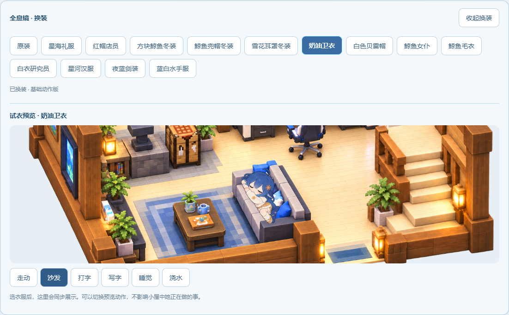

# 伪从绫开始的面板 1.1

**琉璃陪伴中心 · DeepSeek Harness 插件套件**

完整陪伴面板、14 × 10 格 MC 风格双层小屋，以及大肥鱼的生活动作与物品交互。这个包只安装 `dsh-whale-status` 一个面板插件。

**1.1 更新：更多生活动作、13 套服装与常驻试衣预览、家具专属页面，以及跟随用户电脑本地时间的窗外光景。** [完整更新详情](docs/UPDATE_1.1.md) · [下载 1.1.0](https://github.com/xinghailiuli/pseudo-congling-panel/releases/tag/v1.1.0) · [小黑盒发帖稿](docs/XIAOHEIHE_POST.md)

此版本先以预发布提供；自动化与隔离检查已完成，真实 DSH 界面及动作观感仍待使用者验收。



角色素材来源：[PC2005-cloud/dsh-pet](https://github.com/PC2005-cloud/dsh-pet)。原作者允许素材开源使用、禁止商用，衍生作品的介绍、展示和分发须保留原作者链接。功能设计参考：[LUOSHUI319/astrbot_plugin_congling（从绫开始）](https://github.com/LUOSHUI319/astrbot_plugin_congling)。本项目为独立的 DSH 适配实现。

## 包含哪些内容

- 保留全部陪伴功能；人格/记忆、长夜/梦境、日记融入小屋家具，侧栏不再重复列出这五项。
- 电脑打开记忆与人格工作台，附魔台打开日记书，床打开长夜与梦境床边界面，二楼科技镜打开衣柜。
- 双层小屋：一楼客厅与工作区，二楼床铺、书架、附魔区、小麦温室、露台，19 件默认物品，植物装饰、楼梯、分层/总览/放大/人物特写。
- 大肥鱼素材和交互：965 帧原角色图片；摸头、自动生活、盖被子睡觉、写字、敲键盘、沙发休息、散步、阅读、附魔、浇小麦、露台休息和上下楼过渡。
- 最新的正常步态、物品接触遮挡、开放露台，以及温室/左侧过道到露台的直接路径。
- 沙发坐卧与零食、园艺浇水与除草、盖被子与起床、书桌和阅读等连续动作；增加停留时间、工具收起与离座过渡。
- 13 套服装加原装角色；每套服装 16 个基础姿态，支持本地保存选择、切换反馈和独立试衣预览。
- 窗外晨昼暮夜随观看者电脑的本地时间变化；不绑定北京时间或服务器时区。
- 状态持久化、备份、记忆分级与遗忘、关系画像、睡眠与梦境、日记和 QQ 的适配代码。

小屋是 **2D 场景与帧动画**。这些交互在面板内发生，不会启动或操作真实 Minecraft，也不会因点击房间物品向 QQ 发消息。

不包含独立桌宠窗口、速度插件、余额插件、其他 DSH 插件、QQ 机器人服务器、个人聊天/日记/记忆、账号令牌或浏览器布局。

## 安装

适用于 DeepSeek Harness 桌面/网页界面。发布适配基线为 Windows 的 DSH `0.2.0-rc.2`、Node.js 24；本次提供离线测试结果，其他系统与实际界面请自行验证。

1. 从本仓库的 **Releases** 下载 `dsh-whale-status-1.1.0.tgz`，保留 `.tgz` 扩展名。
2. 在下载目录打开终端，安装到你正在使用的 DSH profile。桌面端通常是 `desktop`：

   ```powershell
   dsh plugin --profile desktop add ./dsh-whale-status-1.1.0.tgz
   ```

   网页端使用相应 profile（通常为 `web`）。如果终端找不到 `dsh`，先按 DSH 官方说明配置 CLI。

3. 正常重新载入 DSH 后，从侧栏打开 **琉璃陪伴中心 → 她的房间**。

新用户会得到完整家具和角色；不需要另外安装 `dsh-dafeiyu`。安装包已包含构建产物，安装时不需要编译。不要将整个个人 DSH profile 覆盖为本项目文件。

升级 1.0 时使用同一 profile 和原数据目录安装新版；包名不变。换装在“她的房间 → 二楼 → 镜子”进入，也可使用房间内衣柜按钮。镜子替换挂画的显示，不增加或重置已保存物品。

升级前备份你自己的插件数据。公开版默认数据目录为 `$DSH_HOME/data/dsh-whale-status`；未设置 `DSH_HOME` 时为 `~/.dsh/data/dsh-whale-status`。可使用 `stateRoot` 或 `LIULI_DATA_DIR` 指定独立目录。多个 profile 同时运行时请分别指定目录。已有数据不会被默认家具覆盖；使用本项目早期个人版时，应明确配置原 `stateRoot`，避免看起来像新建了数据。

## 哪些功能需要额外接入

| 功能 | 开箱可用情况 |
| --- | --- |
| 小屋、生活动作、换装预览、本地时段窗景、摸头、视角、灯光/窗帘、物品编辑 | 随包提供，可独立使用 |
| 陪伴设置、睡眠模拟、关系元数据、备份、系统记录 | 使用本插件本地状态 |
| 长期记忆正文与笔记库 | 需用户的 Basic Memory 工具 |
| 日记正文的读取/写入 | 需配置日记文件和日记工具 |
| 梦境、日记、画像的模型生成 | 需 DSH 模型；梦境/日记素材还需要兼容的 QQ 桥接上下文 |
| 人格、主动联系、QQ 资料/空间、消息联动 | 需兼容的外部 QQ 桥接/网关 |

所有功能与适配逻辑都保留。没有配置外部服务时，相关功能会显示未接入或不可用；这不会阻止房间加载。安装包不会附带或自动部署这些外部服务，也不会自动接入本机其他 QQ 账号。

原装角色保留完整细分生活动画；新增服装使用 16 个基础姿态及局部动态，尚未逐套覆盖原装角色全部持物细节。修改默认家具组合后会使用独立物品绘制兼容模式，参考图插画及其精细接触动作以默认 19 件物品布局为基准。

详细配置、API 契约和接入示例见 [docs/INTEGRATIONS.md](docs/INTEGRATIONS.md)。

## 源码开发

源码 ZIP 解压后进入项目目录，使用 Node.js 24：

```powershell
npm run build
npm test
npm pack
```

本项目源代码只依赖 Node 内置模块，前端从 DSH 宿主获取 React。无需复制作者的其他项目或 `node_modules`。`npm pack` 会重新构建并生成 `.tgz`。保留 `lib/` 中的入口、房间/生活素材块和 13 个 `client.wardrobe-*-v1.js` 文件；不要只复制 PNG。

供开发者手动检查的隔离预览：`npm run preview`（端口 18406）或 `npm run preview:motion`（端口 18408）。预览使用虚构数据，不连接 QQ；它不代表实际 DSH 安装验收。

## 开源发布与许可

- GitHub 仓库存放本目录的完整源码；Releases 附上 `.tgz` 和校验文件。操作步骤见 [docs/PUBLISHING.md](docs/PUBLISHING.md)。
- 原创程序代码按 [MIT](LICENSE) 提供。
- `assets/` 素材不在上述 MIT 授权范围内。请阅读 [THIRD_PARTY_NOTICES.md](THIRD_PARTY_NOTICES.md)、[assets/SOURCES.md](assets/SOURCES.md) 和 [原作者说明](https://github.com/PC2005-cloud/dsh-pet#许可)。包含这些素材的整包不能宣传为“全素材 MIT”或可自由商用。

DSH 打包方式依据：[官方插件发布文档](https://github.com/deepseek-ai/deepseek-harness/blob/master/docs/user/develop/basic/publish.md)。
