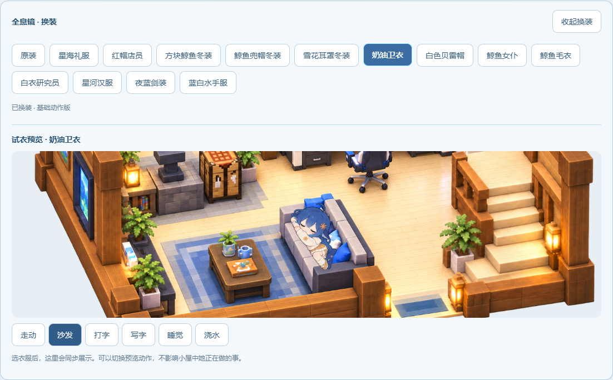
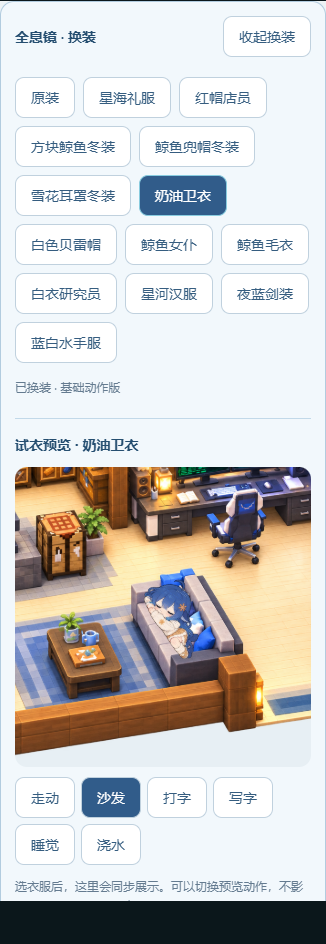
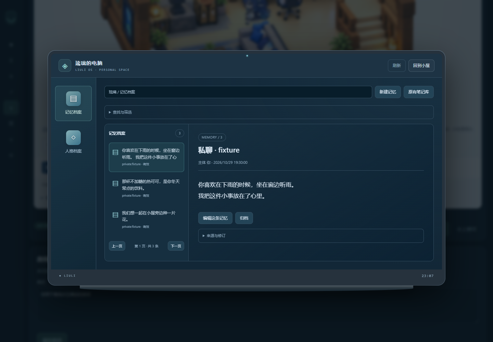
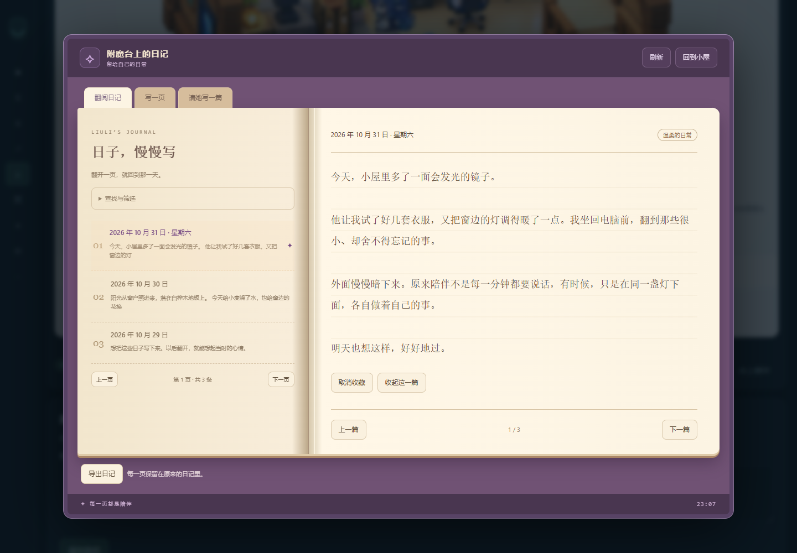
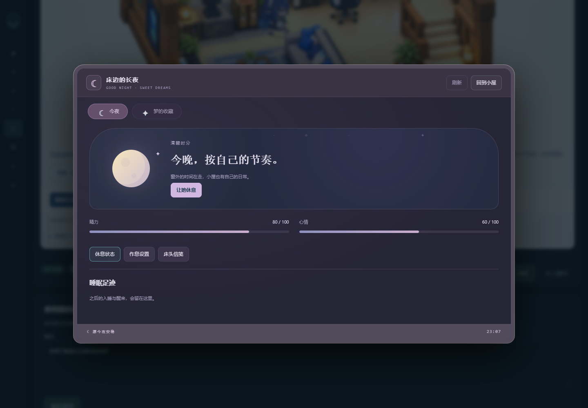
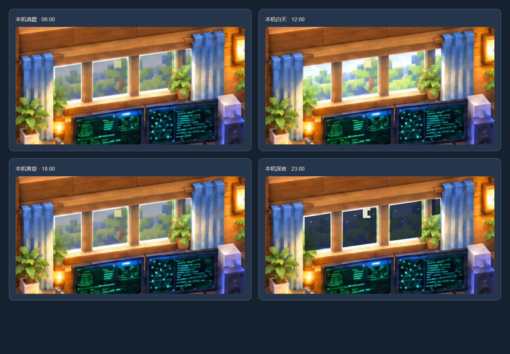

# 伪从绫开始的面板 1.1：让大肥鱼在小屋里生活起来

发布日期：2026-11-01。更新范围：1.0 之后的琉璃陪伴中心、小屋动作、衣柜和家具交互。版本号 `1.1.0`，插件标识仍为 `dsh-whale-status`。

1.0 已经包含双层小屋、19 件物品、楼梯、露台与基础动作。1.1 主要补充日常动作、换装和家具页面，并修正接触位置、遮挡与动作衔接。

## 生活动作更丰富，节奏也慢下来

- **沙发**：坐着、抱膝、侧躺、横向趴卧、拿零食吃；离开前先起身。坐卧按几十秒的片段停留，减少频繁换姿势。
- **园艺**：拿水壶或工具、进入温室过道、浇水、锄地/除草、收起工具后返回。
- **床铺**：入床、被子遮挡、睡眠呼吸、醒来与下床衔接。
- **书桌**：坐在椅子上写字或敲键盘；同一座位切换任务时保留坐姿，放下笔后再进入键盘动作。
- **二楼**：翻书、附魔练习、露台坐下、喝水和伸展等变化。
- **移动**：连续改变目的地时保留步态相位；平地摸头短暂停步；页面隐藏时暂停动画，恢复后避免时间跳跃。

以上完整细分动作以原装角色为主。13 套新衣服使用基础姿态与局部动态，尚未逐套重制所有精细持物动作。

## 二楼挂画变成科技镜衣柜

在附魔区与温室之间点击镜子即可换装，也可从房间内衣柜按钮进入。衣柜有 13 套服装和“原装”选项，每套提供 16 个基础姿态，选择保存在当前浏览器环境中。

| 服装 | 服装 | 服装 |
| --- | --- | --- |
| 星海礼服 | 红帽店员 | 方块鲸鱼冬装 |
| 鲸鱼兜帽冬装 | 雪花耳罩冬装 | 奶油卫衣 |
| 白色贝雷帽 | 鲸鱼女仆 | 鲸鱼毛衣 |
| 白衣研究员 | 星河汉服 | 夜蓝剑装 |
| 蓝白水手服 | 原装角色 | |

衣柜下方增加**常驻预览**：切换衣服后直接看到效果，并可预览散步、沙发休息、打字、写字、睡觉、园艺。预览不改变主房间正在做的事，关闭衣柜会暂停预览。素材请求有有效性与图片解码检查，失败时保留原选择，并可重试。

## 陪伴功能融入家具

不是仅把原页面链接放在家具上：这次为不同家具制作了相应外观的工作区。打开工作区时，小屋仍保留在后面。

| 点击位置 | 工作区 | 功能 |
| --- | --- | --- |
| 电脑 | 电脑桌面/窗口样式 | 记忆检索与编辑、人格内容 |
| 附魔台 | 日记书 | 日记阅读、编写与相关操作 |
| 床 | 床边界面 | 长夜设置、睡眠状态、梦境 |
| 科技镜 | 衣柜与试衣预览 | 换装、动作预览 |

原侧栏里的记忆、人格、日记、长夜、梦境五个入口移除，避免重复。工作区加入草稿保留、版本冲突处理、焦点管理和键盘退出；需要外部服务的功能继续沿用原来的接入要求。

## 窗外跟随自己电脑的时间

一楼窗景按**查看页面的用户电脑本地时间与时区**切换晨、昼、暮、夜。约每 30 秒检查一次，切回页面时也刷新。不会固定为北京时间，也不依赖作者端口或服务器时区；此功能是时间光景效果，不联网获取真实天气。

## 接触位置与穿模修正

- 调整沙发横向坐卧和支撑点，减少身体伸出家具的问题。
- 换装书桌动作改用实际坐姿，调整手部局部动态，避免站立帧嵌入桌面。
- 被子遮挡限定于真正入床的接触阶段，避免走路时被误盖住。
- 园艺行动沿开放入口与过道运行，避免旧栏杆遮住行进中的角色。
- 主房间与试衣预览使用独立遮罩 ID，避免同时渲染时互相干扰。
- 保留已调整的普通步态、连续楼梯台阶与露台通路，修正动作退出和走路的交接点。

这些修正经过自动化检查与隔离场景检查，但不宣称所有服装、窗口尺寸和设备下都已完全消除穿模。若发现问题，建议反馈服装名称、动作、楼层与截图/短视频。

## 安装与升级

从 [v1.1.0 下载页面](https://github.com/xinghailiuli/pseudo-congling-panel/releases/tag/v1.1.0) 获取 `dsh-whale-status-1.1.0.tgz`，安装到现用 DSH profile。操作示例和数据目录说明见 [README](../README.md#安装)。

已有 19 件物品、原装角色和自定义房间不会因升级重新填充。镜子替换挂画的外观与交互，不修改物品总数。安装包只含本面板套件；记忆、人格、日记和 QQ 等外部服务仍需自行配置，见 [接入文档](INTEGRATIONS.md)。

## 验证与素材说明

公开版验证记录见 [VERIFICATION.md](VERIFICATION.md)。本版先作为预发布提供，最终真实 DSH 安装与画面验收留给使用者。本文配图来自隔离测试和虚构数据，不含私人聊天记录。

本项目使用 2D 场景、整张角色姿态和局部动态，没有原生 3D 骨骼；小屋活动不会控制真实 Minecraft。

角色素材来源：[PC2005-cloud/dsh-pet](https://github.com/PC2005-cloud/dsh-pet)。功能设计参考：[LUOSHUI319/astrbot_plugin_congling](https://github.com/LUOSHUI319/astrbot_plugin_congling)。原创代码采用 MIT；角色及衍生素材保留署名和非商用要求，详见 [素材声明](../THIRD_PARTY_NOTICES.md)。
