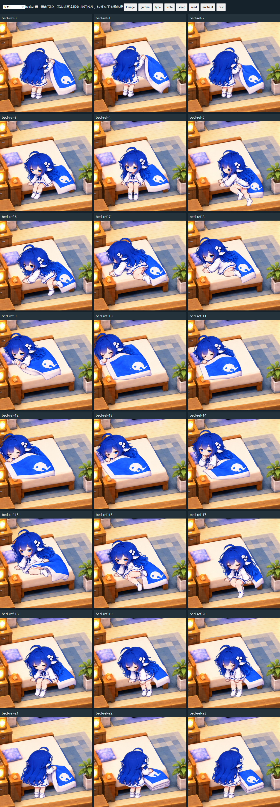
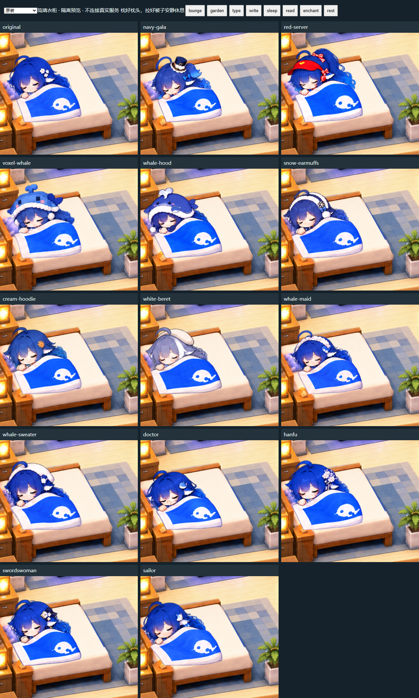
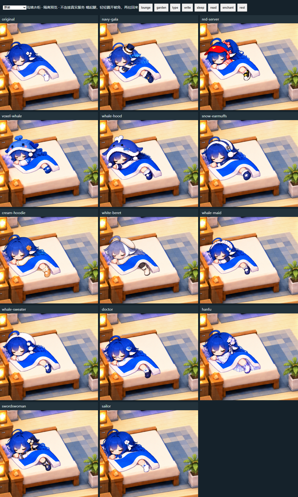

# 1.11 优化版：1.1 之后的动作与小屋更新

发布日期：2026-11-01。展示名称为 **1.11 优化版**，安装包及 Git 标签采用 **1.1.1 / v1.1.1**，表示 1.1 的修订更新。

这次主要完善角色动作、家具接触、睡眠表现和房间状态接续。科技镜衣柜、常驻换装预览、家具专属工作区及本地时间窗景是 1.1 已有功能，本次继续保留。

| 项目 | 本次新增、修复与优化 |
| --- | --- |
| 走路 | 13 套服装各补充 8 帧完整走路素材，调整左右脚交替和脚底接触；修正腿部变形在分界处折叠造成的翻脚。 |
| 书桌坐姿 | 补充面向电脑的坐姿及落座动作，校准身体、膝盖、手部和椅子位置；细分椅背、扶手遮挡，处理半身看起来透明的问题。 |
| 打字与写字 | 稳定身体和头部，将动作集中到局部手部，处理身体扭动及手部变形带动脸颊的问题。 |
| 上床 | 根据参考分镜制作“床边掀被 → 坐床沿 → 支撑抬腿 → 躺到枕边 → 拉被入睡”的独立序列。 |
| 下床 | 使用“醒来 → 推被 → 坐起转腿 → 双脚落地 → 起身 → 折被”的独立序列，补充支撑和落脚姿态。 |
| 枕头与被子 | 重新校准枕边接触及被缘遮挡；上下床增加拉被、推被、折被表现，角色离开后保留床上的折叠被子。 |
| 睡眠小动作 | 新增翻身及概率踢被子，使用角色和被子配合绘制的动作帧，动作之间保留安静停留。 |
| 其他座位过渡 | 沙发、露台座位、书桌补充坐下和站起姿态，处理活动途中改目的地时的退出衔接。 |
| 两层随机散步 | 在一楼前廊、过道、入口、沙发旁及二楼大厅、园区通道、露台等 8 个安全地点之间随机选择目的地，沿通道和楼梯移动。 |
| 重开房间 | 保存楼层、路线、动作阶段、睡眠时钟及被子状态；重新进入时按离开时间接续，处理每次都从一楼开始的问题。 |
| 全服装兼容 | 原装及 13 套服装接入新的床铺序列，每种造型包含 24 个上下床姿态和 16 个翻身/踢被姿态。保留既有基础姿态与其他活动。 |
| 加载保护 | 加强图片解码、尺寸及定位数据校验；换装素材异常时保留当前造型，兼容旧素材与既有房间功能。 |

## 动作节奏与状态恢复

睡眠至少持续 60 秒后才可能播放小动作，随后每 90 秒有一次机会：25% 踢被子、55% 翻身、20% 保持安静。一次小动作约 6.5 秒；切换活动会等这段动作结束再起身。系统开启“减少动态效果”时，不播放新增随机睡眠事件。

随机散步遵循可通行路径，不保证每轮都换楼层。关闭房间后不会持续在后台绘图；重新进入时依据保存状态和离开时间恢复，最多计入 24 小时。不兼容的布局或动作快照会被忽略，以避免恢复到错误位置。

## 安装或从 1.1 升级

下载 [dsh-whale-status-1.1.1.tgz](https://github.com/xinghailiuli/pseudo-congling-panel/releases/download/v1.1.1/dsh-whale-status-1.1.1.tgz)。保留原 profile 和数据目录，用同一个插件包名更新：

```powershell
dsh plugin --profile desktop add ./dsh-whale-status-1.1.1.tgz
```

使用其他 profile 时替换 `desktop`。重新载入 DSH 客户端后进入“琉璃陪伴中心 → 她的房间”。若仍看到旧动作，需重新加载承载插件的客户端；仅关闭再打开房间不一定会刷新已缓存的客户端代码。

升级前备份自己的插件数据。包名、默认数据目录不变，不重置已有房间或重新填入家具。不要覆盖整个 DSH profile，不要清空浏览器存储。房间状态及服装选择跟随当前浏览器来源；更换端口或 profile 不保证自动迁移这些显示状态。

本包包含完整代码、原装角色、13 套服装、构建产物和新增动作素材，不需要额外安装独立桌宠插件。未配置的 QQ、记忆、日记等外部服务仍需自行接入。

## 发布包体积优化

安装包只携带当前运行所需的完整构建代码、内嵌服装/动作素材及图片路由资源，并保留 1.1 公开版兼容块，去除内部修订的重复构建块。源码 ZIP 保留全部可编辑源码、原始动作图片及完整性清单，省略可重新生成的客户端构建文件；开发前请先运行 `npm run build`，再运行 `npm test`。两种包的用途不同，安装包无需编译，源码包可重新生成全部客户端资源。

## 示例与验证范围

下图为隔离环境中的动作关键帧，不是视频，也不代表所有真实 DSH 环境均已完成视觉验收。







发布检查详见 [VERIFICATION.md](VERIFICATION.md)。本版继续标记为预发布：动作仍为 2D 分帧与局部变形，实际流畅度及特定服装下的穿模仍欢迎反馈，不能把离线测试通过理解为所有视觉问题都已消除。

角色素材及衍生作品须署名 [PC2005-cloud/dsh-pet](https://github.com/PC2005-cloud/dsh-pet)，禁止商用。完整范围见 [素材说明](../THIRD_PARTY_NOTICES.md)。
