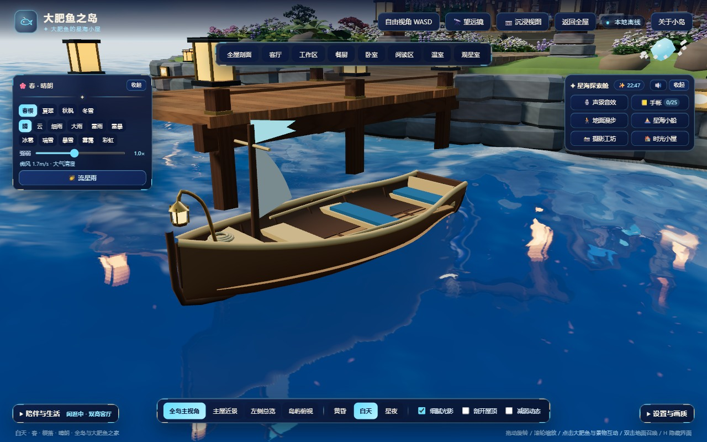
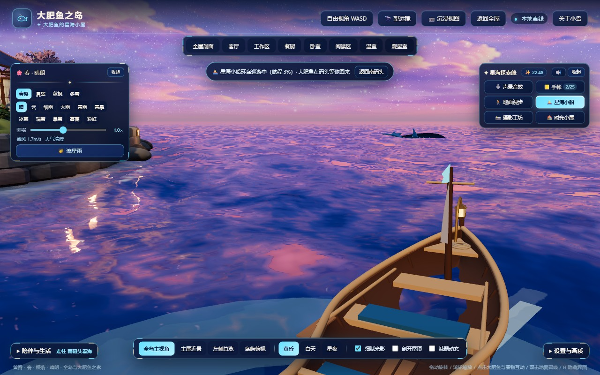
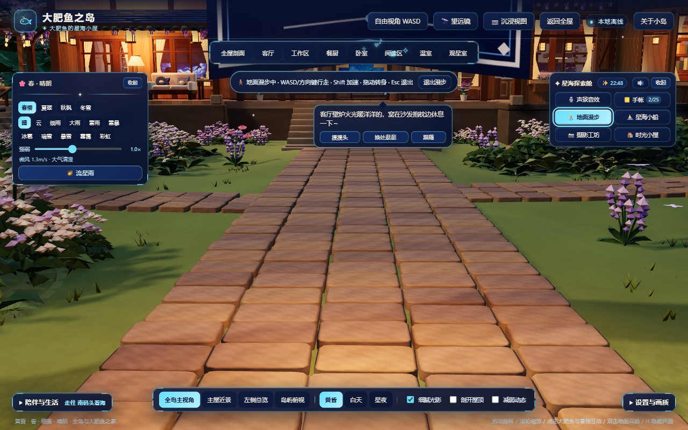
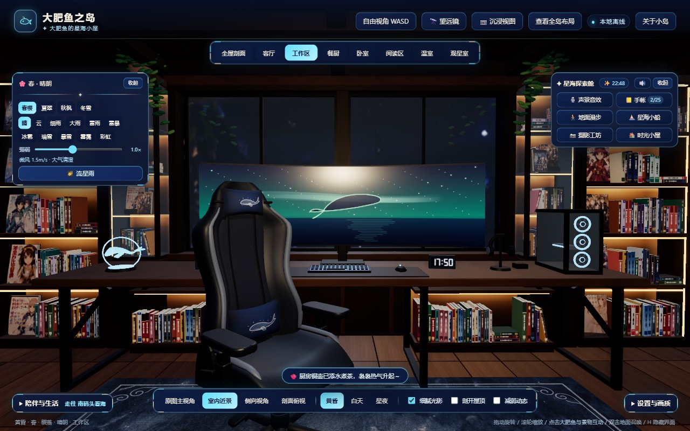
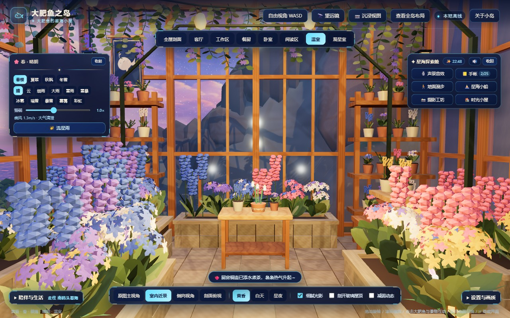

# 星海回响 1.3.2 - 大肥鱼之岛完整更新详情

在 **v1.3.1** 将 3D 鲸鱼小岛的 13 处地标互动与 23 锚点自主漫游打通之后，**v1.3.2** 继续沿 `1.3.x` 小版本线迭代，并将 3D 小岛正式命名为 **「大肥鱼之岛」**，集中解决上一版“南码头木船像块板子”、“缺少探索收集目标”以及“高画质与中低配流畅度波动”等核心问题。

## 一、南码头星海小船重塑与环岛巡游

1.3.1 版本的码头小船只是简单木板拼装；1.3.2 版从头雕刻了完整立体船体：

- **立体弧线船体与工艺细节**：建造曲率弧形龙骨与深棕实木船壳，内嵌实木船肋、浅木舷缘、两排带靛蓝软垫的实木长凳、船首弯钩式暖光金属提灯、微倾桅杆与风帆、顶部燕尾星海小旗，并渲染柔和尾流与水面倒影。
- **一键环岛巡游**：走到南码头或点开右上角「星海探索舱 -> 星海小船」即可登船开启环岛航行；巡游结束后平滑恢复登船前的观察镜头。
- **状态互斥保护**：巡游状态下点击天文望远镜「🔭 望远镜」或按快捷键 `T` 会先安全下船并收束镜头再进入观测，避免视角冲突。

## 二、离岸蓝鲸生态与分级海鸥蝶群

- 离岸海域常驻跃水蓝鲸（带喷水与水面波纹环），支持周期自然跃水与触发跃水。
- 海鸥与岛屿蝴蝶数量按「极速 / 平衡 / 精细」画质档位动态缩放，兼顾低配流畅度与高画质生态氛围：
  - **极速（fast）**：8 只海鸥 / 12 只蝴蝶
  - **平衡（balanced）**：18 只海鸥 / 26 只蝴蝶
  - **精细（high）**：32 只海鸥 / 44 只蝴蝶

## 三、地面第一人称漫步与 2K 摄影工坊

- **地面漫步模式**：通过星海探索舱进入第一人称漫步视角，沿全岛石板路、木桥与门廊实际高度行走（支持 WASD / 方向键移动与 Shift 加速），按键状态与自由飞航彻底隔离；走近大肥鱼即可弹出抚摸互动气泡。
- **星海摄影工坊**：内置「原生星海」「暖阳胶片」「柔光梦境」「月夜青岚」「复古金晖」5 套胶片滤镜、柔光开关与合照 Pose，一键导出带时间戳水印的 **`2048x1152`（2K）星海明信片 PNG**；退出工坊自动清理画布滤镜。

## 四、Web Audio 实时程序化声景与星海手帐 25 项收集

- **Web Audio 程序化声景与音效**：零外部音频文件依赖，点击操作即解锁 AudioContext，按晴、雨、雪、雾、雷暴天气以及海边/室内位置实时合成声景与交互反馈音效，支持一键静音与切后台平滑收敛。
- **星海手帐（0/25）**：
  - 13 处全岛室内外地标互动打卡
  - 6 枚环岛探索拾遗（南岸浅滩海螺、东南石岸漂流瓶、西侧花径四叶草、东岸琥珀、北麓草甸陨石、西池夜光晶）
  - 6 个天文望远镜抓拍天体（鲸鱼座、月球、土星环、猎户座、北斗七星、流星辐射点）
  - 数据隔离保存在本地独立存储键中，刷新或重载页面后保留；随陪伴亲密度（30 / 65 / 110）解锁「四叶草发卡」「荧光海螺佩」「星海小皇冠」挂饰。

## 五、时光小屋实景同步与室内交互道具

- **现实时间段同步**：按本地时间自动区分清晨朝霞、日光晴昼、日落晚霞与星夜月涌四套光影及大肥鱼作息。
- **工作区 49 寸带鱼屏与专注钟**：提供「深海蓝鲸」「极光星野」「晚霞余晖」「春樱微光」4 套 1536x480 宽屏程序壁纸、桌面数字时钟与番茄钟计时器。
- **餐厨与温室交互**：厨房铜茶壶点击可添水煮茶冒热气；玻璃温室一键洒水触发水雾与花丛绽放；二层书廊收录 5 章原创《大肥鱼之岛栖居志》故事与书签持久化。

## 六、流畅度调优与全面自测结果

围绕水面倒影调度、GTAO 接触阴影采样缓存、漫游网格分配与批处理合批优化后，本地重打包实测全部通过：

- **自动化测试**：`node --test tests-v2/*.test.mjs tests/*.test.mjs` **97/97 全部通过**（0 失败，0 跳过）。
- **Edge 真实 WebGL 帧时基准（`perf-bench.mjs`, 1280x800）**：
  - 星海小船环岛巡游（精细画质）：P50 `16.6ms`（P95 `26.8ms`），GPU P50 `9.69ms`，171 DrawCalls，1,024,302 三角面
  - 地面漫步（精细画质）：P50 `26.6ms`（P95 `80.0ms`），GPU P50 `21.09ms`，1,088 DrawCalls
  - 极速画质待机：P50 `23.4ms`（P95 `53.3ms`），GPU P50 `19.97ms`，959 DrawCalls
  - 平衡画质待机：P50 `23.4ms`（P95 `50.0ms`），GPU P50 `22.96ms`，1,041 DrawCalls
  - 精细画质待机：P50 `30.0ms`（P95 `70.0ms`），GPU P50 `26.14ms`，1,128 DrawCalls
- **多端零重叠验收（`verify-v2.mjs`）**：1280x800、522x593（窄侧栏）、390x844（移动端）全部通过相邻 HUD 组件重叠断言（overlap <= 2px），全程 `0` console 错误、`0` page 错误、`0` 外部网络请求。
- **独立离线包启动与 DSH 宿主实测**：`dafeiyu-island-1.3.2-offline.zip`（`20,037,852` 字节）通过 `113` 项保护清单校验，解压后在 Edge 中以本地 `file://` 直接打开 `开始使用.html` 并点击进入场景，全 15 个文件 SHA-256 校验通过，小船巡游与地面漫步均无报错；同步 `star-echo-r29` 集成并跑通 DSH 宿主内嵌 E2E，非 CSP 错误为空。
