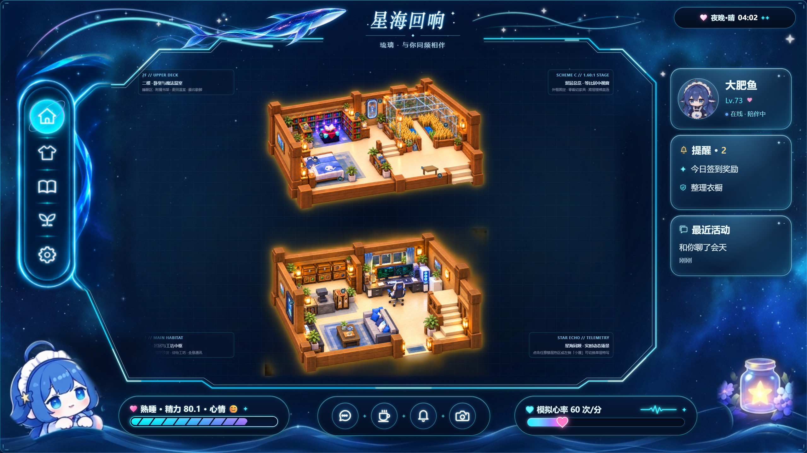

# 伪从绫开始的面板 1.3 · 完全重制版

本次汇总 **v1.2.0 之后**的更新。安装包版本 `1.3.0`，插件身份仍为 `dsh-whale-status`。

## 星海回响 HUD

- 发光鲸鱼、标题与光轨统一为星海主题，修正标题可读性与遮挡。
- 左侧保留五个入口，改为胶囊导航，选中项增加克制的蓝紫色环绕动画。
- 右侧按角色、提醒、最近活动分成三张卡，统一边框、文字层级与留白。
- 保留底部三组胶囊；1080p 与 1440p 共用比例规则，处理浮层、字体穿透和宿主组件的样式隔离。

## 边看动作，边操作

- 陪伴操作改为底部紧凑动作面板，减少遮挡小屋；提供生活动作、家具互动、小屋切换、帮助入口。
- 保留 **11 项生活动作**：随她生活、摸摸头、散步、沙发休息、写字、敲键盘、盖被睡觉、书架翻书、附魔练习、照料小麦、露台歇脚。
- 加固动作切换与退出、重复进入、楼层与状态恢复；素材加载失败时提供诊断与重试。
- 修正沙发接触、桌椅遮挡、上下床衔接与独立被子运动；原装和服装继续使用完整角色二维素材。

## 更衣室与书架

- 更衣室重做为侧边试衣舞台，左侧仍能观察小屋；保留原装与 **13 套服装**，提供选择、收藏、保存穿搭和随机搭配。
- 移除衣服列表下方重复的动作预览，减少冗余显示与渲染。
- 资源按当前服装加载，处理重复点击、异步解码超时、过期结果回写以及缓存淘汰。
- 小屋书架内置原创短篇，支持翻页、续读、独立阅读记录；可导入 **TXT、Markdown、无加密 EPUB**（单文件最多 10 MB、正文最多 200 万字符）。阅读数据保存在本机，不写入聊天、日记或长期记忆。

## 精力会随活动变化

精力值与进度条共用同一份本机状态，并保留到下次打开。进入动作后才按实际活动计时；前往沙发或床的路程按移动计算。关闭或隐藏页面时暂停，不补算离线睡眠。

| 活动 | 每分钟变化 |
| --- | ---: |
| 睡眠 | +2 |
| 沙发 / 露台休息 | +0.8 |
| 待命 | +0.1 |
| 散步 | -0.3 |
| 写字 / 敲键盘 | -0.6 |
| 园艺 | -0.8 |
| 阅读 | -0.2 |
| 附魔练习 | -0.4 |

点击精力条查看活动与变化速率，并可直接去沙发或床休息；不再误开待办提醒。心率为随状态变化的**模拟心率**，不是人体传感器测量。小屋精力与 QQ 长夜自动睡眠策略分开，不会因休息动画发出 QQ 消息。

## 结构与加载修复

- 房间区域、共享动作系统、HUD、衣橱、书架、家具工作区按职责拆分；可选功能的代码和样式按需加载。
- 花海岛独立加载与销毁，补齐样式依赖，修复页面错乱和返回小屋后的残留；保留小屋与海岛各自的交互范围。
- 小型资源索引优先加载，当前服装的必要图集并行解码，避免重复大数据投递；页面隐藏时暂停动画。
- 截图改用 Blob 与有界并发处理，退出页面后取消过期导出，避免大段图片字符串和重复导出堆积。
- 使用内容哈希图片路径，检查资源完整性；143 张运行时 PNG 增加无损 WebP 交付副本，RGBA 像素与原图逐张一致。
- 同一版本候选完整 ZIP 从 **328.32 MB 降至 267.86 MB，减少 18.41%**。这是压缩前后候选包的可比测量，不是与 v1.2 的 441 KB 增量补丁相比；公开 TGZ 与源码 ZIP 的准确大小见 Release 附件。

## 安装与边界

本次提供完整安装包，**不需要逐个叠加旧补丁**。升级前保留原 profile 和插件数据，用自己的 profile 安装 `dsh-whale-status-1.3.0.tgz`。若更新后仍使用旧的资源服务、出现图片 404，请结束运行中任务后正常重启 DSH，再打开面板；不要清理聊天或浏览器存储。

小屋是 2D 场景与动画，花海岛是独立 3D 页面。小屋交互不控制真实 Minecraft。QQ、记忆、日记和模型服务仍需使用者自行接入。

加载、换装及导出已做优化与回归，但具体速度受机器与宿主负载影响，仍有波动，不承诺零卡顿。最终无损发布构建经过自动化、解包和隔离浏览器检查；没有在所有 DSH 版本、机器和全部服装动作组合上逐项完成原生人工验收。详情见 [验证范围](VERIFICATION.md)。

角色来源：[PC2005-cloud/dsh-pet](https://github.com/PC2005-cloud/dsh-pet)；功能设计参考：[从绫开始](https://github.com/LUOSHUI319/astrbot_plugin_congling)。程序代码 MIT；角色与衍生素材须保留署名、禁止商用，详见 [素材说明](../THIRD_PARTY_NOTICES.md)。展示图为本版实际界面的隔离演示数据。
