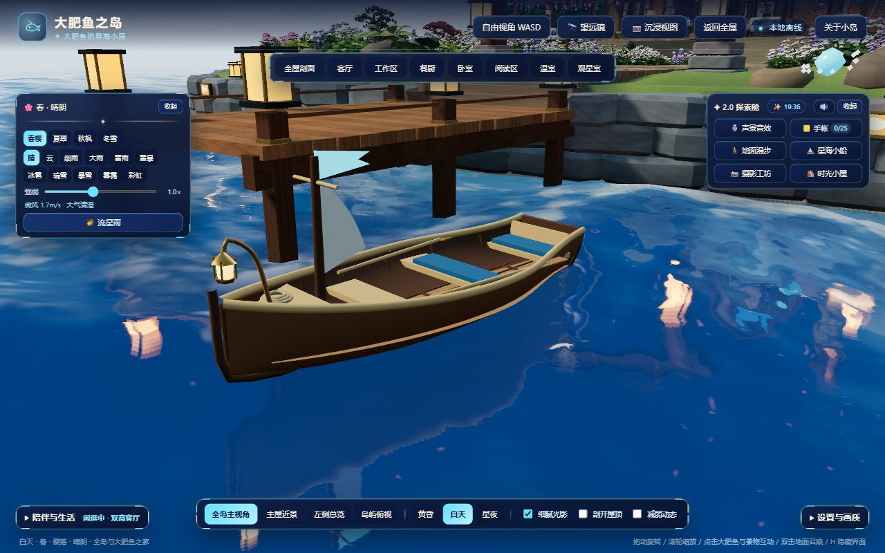
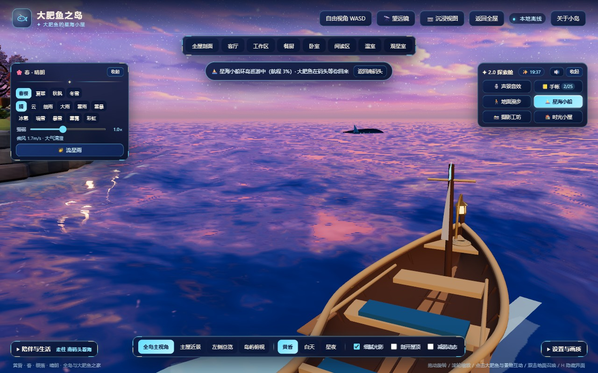
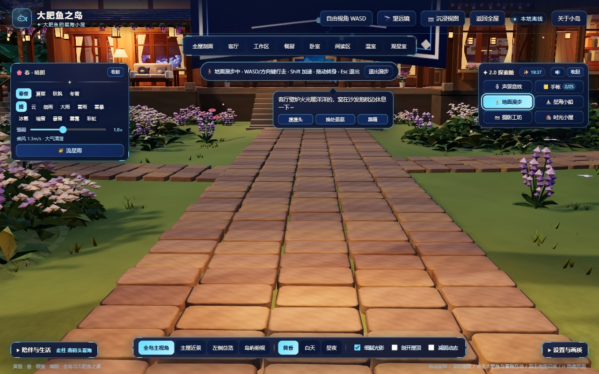
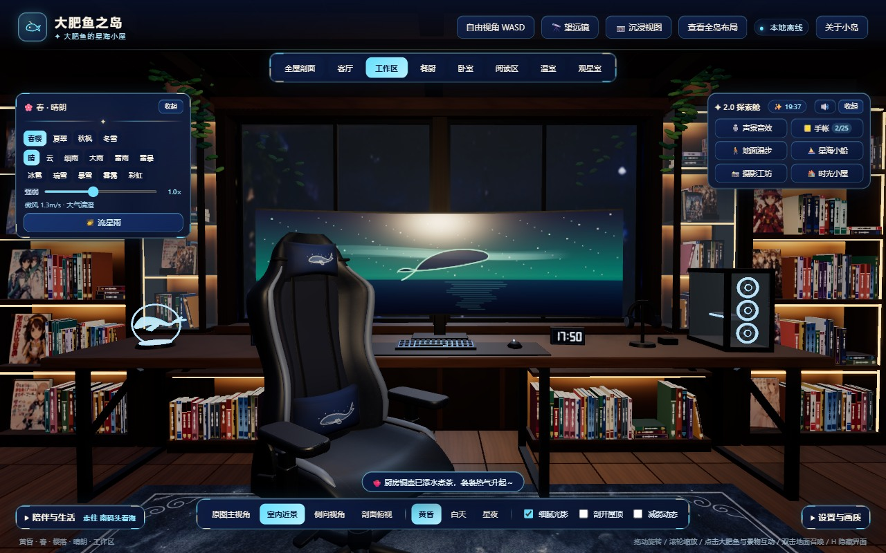
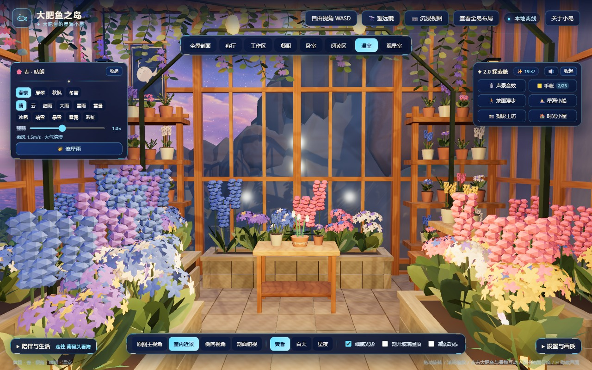

# 大肥鱼之岛 2.0 完整更新详情

在 **v1.3.1** 将 3D 鲸鱼小岛的 13 处地标互动与 23 锚点自主漫游打通之后，**v2.0.0** 正式将独立 3D 海岛体验定名为 **《大肥鱼之岛 2.0》**，重点针对“木船外观太简陋”、“探索玩法单薄”、“高画质与中低配置流畅度”以及“多端界面排版”四方面完成彻底重塑。

## 一、南码头星海小船重塑与环岛巡游

1.3.1 版本的码头小船仅是简单木板组合；2.0 版推倒重做了完整的船体雕塑几何：

- **立体弧线船体与工艺细节**：建造曲率弧形龙骨与深棕实木船壳，内嵌实木船肋、浅木舷缘、两排带靛蓝星海软垫的木质长凳、船首弯钩式暖光金属提灯、微倾桅杆与风帆、顶部燕尾星海小旗，并渲染柔和尾流与水面倒影。
- **一键环岛巡游**：走到南码头或打开「2.0 探索舱 → 星海小船」即可登船开启环岛航行；巡游结束后自动平滑恢复登船前的观察镜头。
- **状态互斥保护**：巡游状态下点击天文望远镜「🔭 望远镜」或按快捷键 `T` 会先安全下船并收束镜头再进入观测，避免视角冲突。

## 二、离岸蓝鲸生态与分级海鸥蝶群

- 离岸海域常驻跃水蓝鲸（带呼吸水柱与水面波纹环），支持定期自然跃水及外部触发跃水动画。
- 海鸥与岛屿蝴蝶数量随画质档位自动分级，在保证低档位帧率的同时保留高画质生态氛围：
  - **极速（fast）**：8 只海鸥 / 12 只蝴蝶
  - **平衡（balanced）**：18 只海鸥 / 26 只蝴蝶
  - **精细（high）**：32 只海鸥 / 44 只蝴蝶

## 三、地面第一人称漫步与 2K 摄影工坊

- **地面漫步模式**：通过探索舱进入第一人称漫步视角，沿全岛石板路、木桥与门廊实际高度行走（支持 WASD / 方向键移动与 Shift 加速），按键状态与自由飞航完全隔离，不再互相抢占控制权；走近大肥鱼即可弹出抚摸互动气泡。
- **星海摄影工坊**：内置「原生星海」「暖阳胶片」「柔光梦境」「月夜青岚」「复古金晖」5 套胶片滤镜、柔光开关与合照 Pose，一键生成带时间戳水印的 **`2048x1152`（2K）高分辨率明信片 PNG**；退出工坊自动清理画布滤镜。

## 四、Web Audio 实时程序化声景与星海手帐 25 项收集

- **Web Audio 程序化声景与音效**：无需任何外部音频素材包，用户点击操作即解锁 AudioContext，按晴、雨、雪、雾、雷暴天气以及海边/室内位置实时合成声景与交互反馈音效，支持一键静音与页面切后台自动渐隐暂停。
- **星海手帐（0/25）**：
  - 13 处全岛室内外地标互动打卡
  - 6 枚环岛探索拾遗（南岸浅滩海螺、东南石岸漂流瓶、西侧花径四叶草、东岸琥珀、北麓草甸陨石、西池夜光晶）
  - 6 个天文望远镜抓拍天体（鲸鱼座、月球、土星环、猎户座、北斗七星、流星辐射点）
  - 数据隔离保存在 `v2` 本地存储空间，刷新或重载页面后完整保留；随陪伴亲密度累积（30 / 65 / 110）逐步解锁「四叶草发卡」「荧光海螺佩」「星海小皇冠」挂饰。

## 五、时光小屋实景同步与室内交互道具

- **现实时间段同步**：按本地时间自动区分清晨朝霞、日光晴昼、日落晚霞与星夜月涌四套光影及大肥鱼作息安排。
- **工作区 49 寸带鱼屏与专注钟**：提供「深海蓝鲸」「极光星野」「晚霞余晖」「春樱微光」4 套实时绘制的 1536x480 宽屏壁纸、同步桌面数字时钟与番茄钟专注计时器。
- **餐厨与温室交互**：厨房铜茶壶点击即可添水煮茶升起袅袅热气；玻璃温室可一键洒水触发水雾与绣球/风信子绽放效果；二层阅读书廊内置 5 章《大肥鱼之岛栖居志》故事与书签持久化。

## 六、流畅度专项优化与全面自测结果

围绕水面倒影调度、GTAO 接触阴影采样缓存、漫游网格分配与批处理合批做了多轮优化，实测指标全部由本地源码重打包后实机跑通：

- **自动化单测与集成回归**：`node --test tests-v2/*.test.mjs tests/*.test.mjs` **97/97 全部通过**（0 失败，0 跳过）。
- **Edge 真实 WebGL 帧时基准（`perf-bench.mjs`, 1280x800）**：
  - 星海小船环岛巡游（精细画质）：P50 `23.4ms`，GPU P50 `13.08ms`，186 DrawCalls，1,055,811 三角面
  - 地面漫步（精细画质）：P50 `50.0ms`，GPU P50 `39.62ms`，1,130 DrawCalls
  - 极速画质待机：P50 `36.6ms`，GPU P50 `31.48ms`，959 DrawCalls，2,362,046 三角面
  - 平衡画质待机：P50 `63.3ms`，GPU P50 `53.65ms`，1,055 DrawCalls
  - 精细画质待机：P50 `76.6ms`，GPU P50 `63.66ms`
- **多端响应式零重叠校验（`verify-v2.mjs`）**：1280x800、522x593（IDE 窄栏）、390x844（移动端）全部通过相邻 HUD 组件重叠断言（overlap <= 2px），全程 `0` console error、`0` page error、`0` 外部网络请求。
- **独立离线包启动实测**：`dafeiyu-island-2.0-offline.zip`（`20,037,850` 字节）通过防覆盖清单校验（`113` 项受保护文件无改动），解压后在 Edge 中以本地 `file://` 直接打开 `开始使用.html` 并点击进入 3D 场景，全 15 个文件 SHA-256 校验通过，小船巡游与地面漫步均无异常与外网请求。
